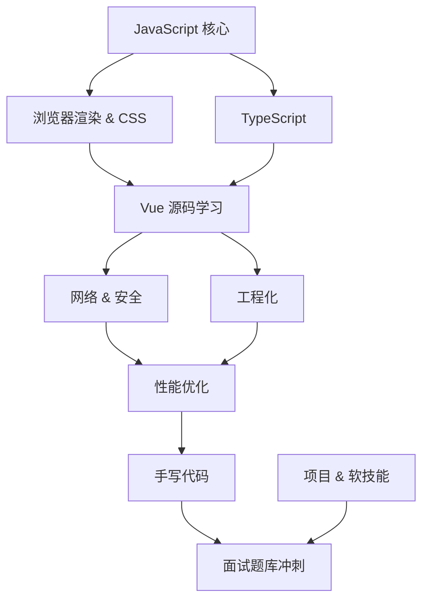

---
layout: home
hero:
  name: "前端知识体系"
  text: "Vue 源码 & 前端基础"
  tagline: 从 Vue 2.x / 3.x 核心源码到 JavaScript、浏览器、工程化，构建完整的前端知识体系
  actions:
    - theme: brand
      text: 🧩 Vue 源码学习
      link: /vue/
    - theme: alt
      text: 学习指南
      link: /guide/getting-started

features:
  - icon: 🧩
    title: Vue 源码学习
    details: Vue 2.x 响应式系统、虚拟 DOM、模板编译、组件化 + Vue 3.x Proxy 响应式、Composition API、编译优化
    link: /vue/

  - icon: 📜
    title: JavaScript 核心
    details: 原型链、this 绑定、闭包、事件循环、Promise、WeakMap/Map、Proxy & Reflect、Class
    link: /frontend/js-core/

  - icon: 🎨
    title: 浏览器渲染 & CSS
    details: 渲染流程、重排重绘、BFC、层叠上下文、Flex & Grid、CSS 工程化、移动端适配
    link: /frontend/browser/

  - icon: 📘
    title: TypeScript
    details: 基础类型、interface vs type、泛型、工具类型手写、Vue 3 TS 实践、声明文件
    link: /frontend/typescript/

  - icon: 🌐
    title: 网络 & 安全
    details: HTTP 各版本、HTTPS/TLS 握手、CORS 跨域、Cookie & 存储、缓存策略、XSS & CSRF
    link: /frontend/network/

  - icon: ⚙️
    title: 工程化
    details: Webpack vs Vite、打包优化、Babel、ESM vs CommonJS、Source Map、CI/CD、包管理、ESLint
    link: /frontend/engineering/

  - icon: ⚡
    title: 性能优化
    details: 性能指标、首屏加载优化、渲染性能、图片优化、实战案例
    link: /frontend/performance/

  - icon: ✍️
    title: 手写代码
    details: 防抖节流、深拷贝、new/call/bind、Promise、发布订阅、LRU、Vue 手写实现
    link: /frontend/handwriting/

  - icon: 💼
    title: 项目 & 软技能
    details: 技术选型与架构设计、线上问题排查思路、团队协作与职业成长
    link: /frontend/project/

  - icon: 📝
    title: Vue 面试题库
    details: 43 道 Vue 2/3 高频面试题，响应式、虚拟 DOM、编译、综合 + 新特性全覆盖
    link: /interview

  - icon: 🔷
    title: TypeScript 面试题库
    details: 23 道 TS 高频面试题，基础类型、泛型、工具类型、高级类型、工程化全覆盖
    link: /ts-interview
---

## 📖 快速导航

| 模块 | 适合人群 | 建议用时 |
|:--|:--|:--|
| [Vue 源码学习](/vue/) | 1~5 年 Vue 开发者 | 2~4 周 |
| [JavaScript 核心](/frontend/js-core/) | 所有前端 | 1~2 周 |
| [浏览器渲染 & CSS](/frontend/browser/) | 所有前端 | 1 周 |
| [TypeScript](/frontend/typescript/) | 有 JS 基础 | 1 周 |
| [网络 & 安全](/frontend/network/) | 1~3 年经验 | 3~5 天 |
| [工程化](/frontend/engineering/) | 1~5 年经验 | 1 周 |
| [性能优化](/frontend/performance/) | 2~5 年经验 | 3~5 天 |
| [手写代码](/frontend/handwriting/) | 面试冲刺 | 1 周 |
| [Vue 面试题库](/interview) | 面试冲刺 | 2~3 天 |
| [TS 面试题库](/ts-interview) | 面试冲刺 | 1~2 天 |

## 🗺️ 学习路线建议

> **提示**：已有 Vue 开发经验可以 JS 核心 + Vue 源码并行推进，遇到 JS 盲点再去补齐。