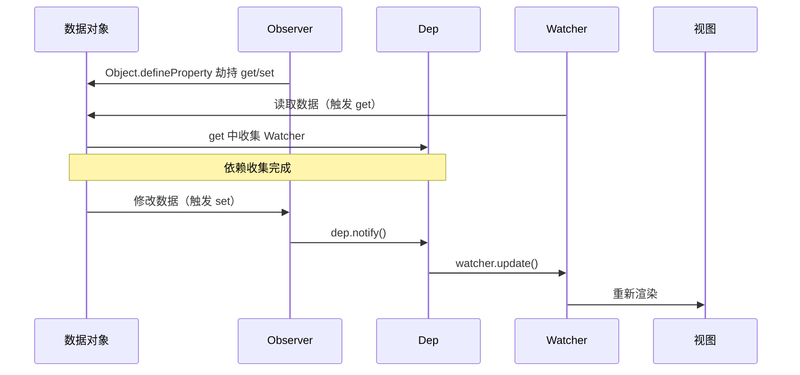

# 响应式系统概述

## 什么是响应式

响应式就是**数据变化时，视图自动更新**。Vue 2 的核心实现依托三个类：

```
Observer（数据劫持）→ Dep（依赖收集）→ Watcher（订阅更新）
```

## 整体流程



## 核心源码文件

| 文件 | 导出 | 职责 |
|------|------|------|
| `observer/index.js` | `Observer`, `defineReactive` | 数据劫持 |
| `observer/dep.js` | `Dep` | 依赖管理 |
| `observer/watcher.js` | `Watcher` | 订阅者 |
| `observer/scheduler.js` | `queueWatcher`, `nextTick` | 异步队列 |
| `observer/array.js` | `arrayMethods` | 数组方法重写 |

## 全局唯一的 Dep.target

```js
// src/core/observer/dep.js
Dep.target = null
const targetStack = []

export function pushTarget(target) {
  targetStack.push(target)
  Dep.target = target
}

export function popTarget() {
  targetStack.pop()
  Dep.target = targetStack[targetStack.length - 1]
}
```

`Dep.target` 是全局唯一变量，指向**当前正在计算的 Watcher**。

当组件渲染时：
1. 创建一个渲染 `Watcher`
2. `pushTarget(渲染Watcher)` → `Dep.target` 指向它
3. 执行 `vm._render()` → 读取 data 中所有属性
4. 每个属性的 `get` 中调用 `dep.depend()` → 把当前 Watcher 加入 subs
5. `popTarget()` → 恢复上一个 Watcher

这样就完成了**依赖收集**——数据知道自己被谁使用了。
